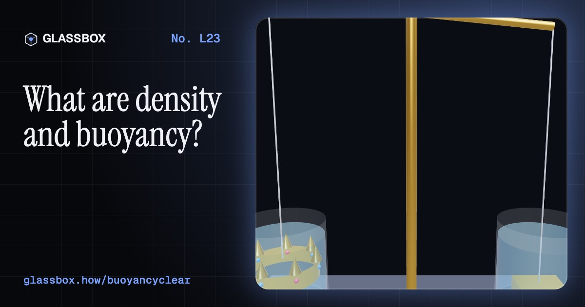
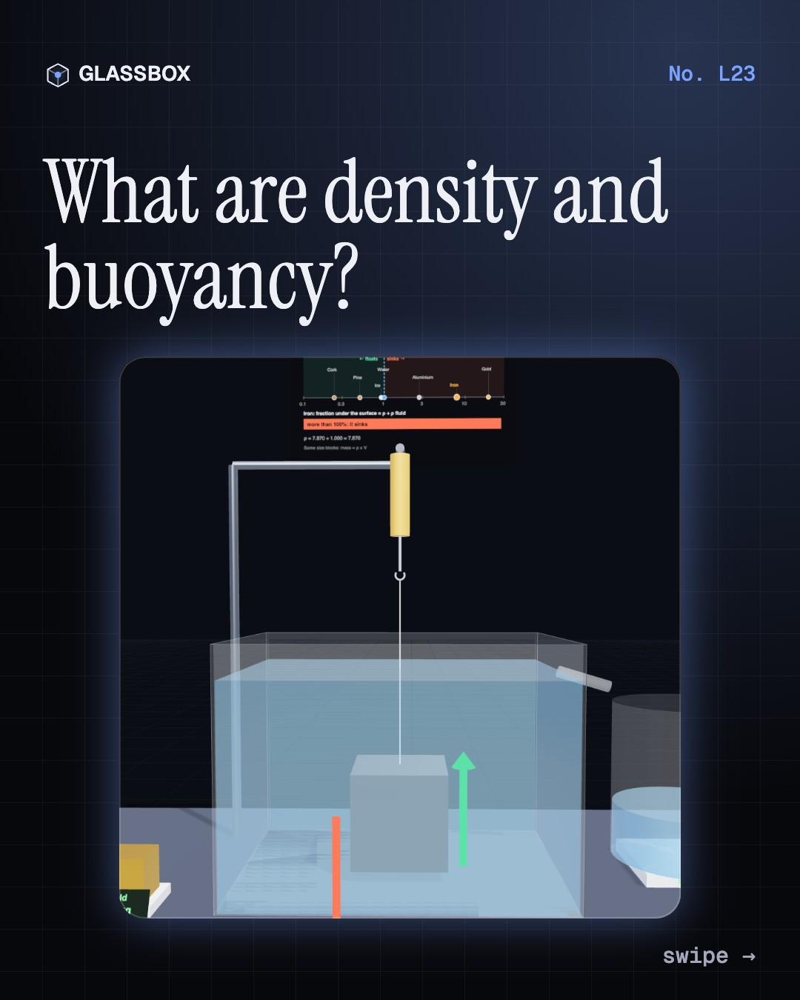
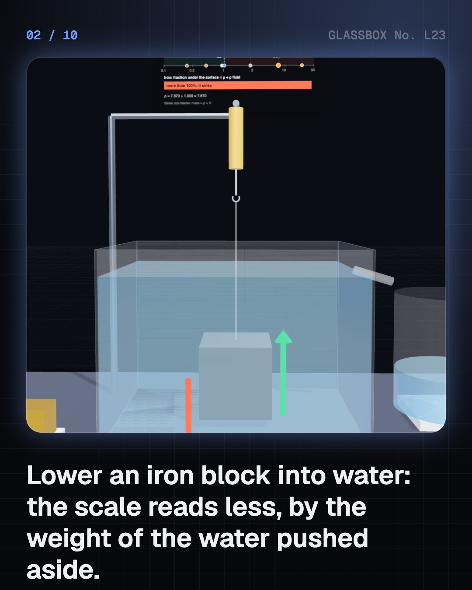
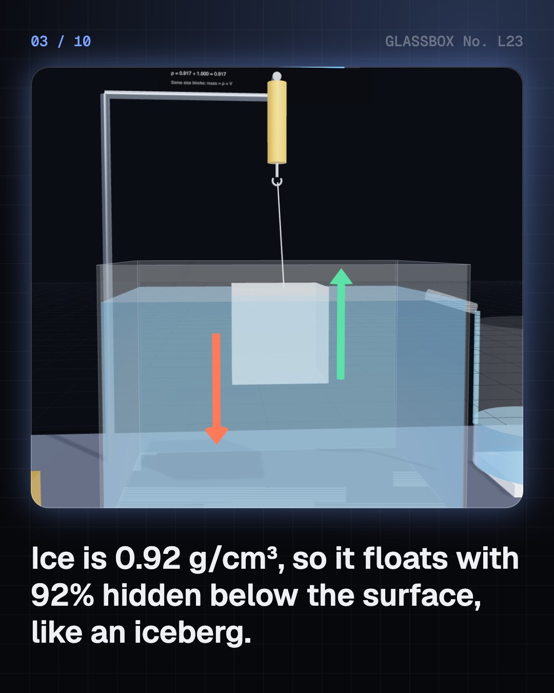
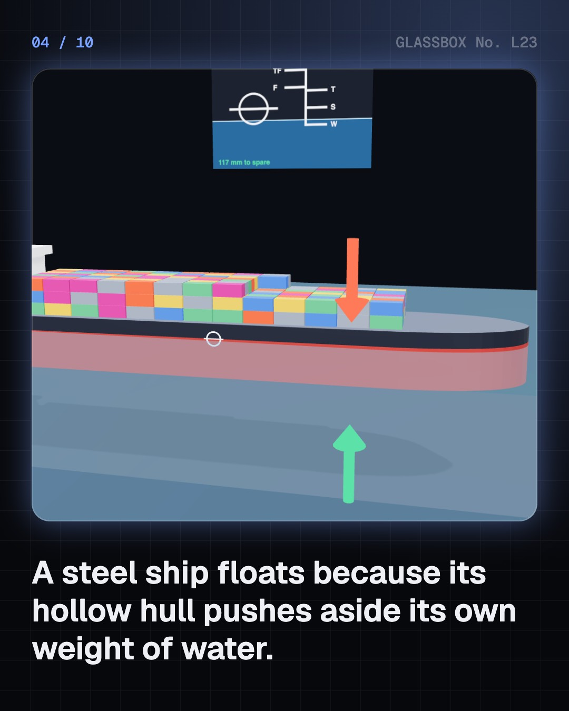

<!-- glassbox:start -->
<!-- Generated from glassbox.json by the Glassbox hub (npm run readme -- buoyancyclear). Edit glassbox.json, not this block. -->
<p align="center"><a href="https://glassbox.how/e/buoyancyclear/"></a></p>

<h1 align="center">Density and buoyancy</h1>

<p align="center"><b>What are density and buoyancy?</b><br>Why does a 100,000-tonne steel ship float while a nail sinks? Lower blocks of cork, ice, iron and gold into a brim-full can, load a cargo ship to its Plimsoll line, test Archimedes' crown, fly a hot-air balloon, dive a submarine and float in the Dead Sea.</p>

<p align="center"><a href="https://glassbox.how/buoyancyclear/"><b>▶ Play with it</b></a> &nbsp;·&nbsp; <a href="https://glassbox.how/e/buoyancyclear/">Read the 60-second explainer</a> &nbsp;·&nbsp; <a href="https://glassbox.how/buoyancyclear/glassbox/reel.mp4">Watch the 40-second video</a></p>

<p align="center">
  <a href="https://glassbox.how/e/buoyancyclear/"></a>
  <a href="https://glassbox.how/e/buoyancyclear/"></a>
  <a href="LICENSE"></a>
  <a href="LICENSE-CONTENT.md"></a>
  <a href="#privacy"></a>
</p>

## In 60 seconds

1. **Density and the upward push.** Density is mass ÷ volume: water is 1 g/cm³, cork 0.24, iron 7.87, gold 19.3. A fluid pushes up with the weight of the fluid pushed aside, F = ρ × V × g. Less dense than the fluid, it floats with ρ_object ÷ ρ_fluid under the surface: 92% for ice.
2. **Ships, clay and a crown.** A steel ship floats because its hollow hull averages less than 1 g/cm³. Load lines show how deep it may sit, a little deeper in fresh water than salt. A clay lump sinks but a clay bowl floats, and silver mixed into a gold crown makes it bigger, so water pushes it up harder.
3. **Floating on air.** Air at 100 °C is 20% lighter than at 20 °C, so a balloon of it lifts hundreds of kilograms. Hot water floats to the top of a geyser, and cold AC air sinks, which is why the AC goes high on the wall.
4. **Swimmers, fish and submarines.** A big breath makes most people float. Fish tune their density with a gas-filled swim bladder, submarines with ballast tanks. Salt makes water denser until a fresh egg floats, and liquids stack by density.
5. **Surprises and myths.** Water is densest at 4 °C, so lakes freeze from the top down. The Dead Sea, 1.24 g/cm³, holds a fifth of you out of the water. Astronauts train neutrally buoyant in a 12 m pool. Heavy logs float and small nails sink, and deep water doesn't float a boat any better.

## Words worth knowing

| Term | Meaning |
|---|---|
| **Density (ρ)** | Mass divided by volume, in kg/m³ or g/cm³. Water is 1,000 kg/m³. |
| **Buoyant force** | The upward push of a fluid, equal to the weight of the fluid displaced. |
| **Archimedes' principle** | F = ρ_fluid × V_submerged × g: a body in a fluid is pushed up by the weight of the fluid it pushes aside. |
| **Displacement** | The fluid an object pushes aside; for a ship, the mass of water equal to the ship's own mass. |
| **Average density** | Total mass over the total volume enclosed, air spaces included. It decides whether a ship floats. |
| **Neutral buoyancy** | Exactly as dense as the surrounding fluid, so it neither rises nor sinks. |
| **Convection** | Warm, lighter fluid rising and cool, denser fluid sinking, carrying heat with it. |
| **Load line** | The Plimsoll mark on a ship's side showing the deepest it may legally float. |

## A short history

**From a king's crown in Syracuse to stitched ships, balloons, bathyscaphes and submarines.**

- **250 BCE** · Archimedes writes On Floating Bodies (Archimedes, Syracuse, Sicily)
- **15 BCE** · Eureka! The story of the king's crown (Vitruvius, retelling a story about Archimedes, Rome)
- **1612** · Why ice floats: Galileo's floating bodies (Galileo Galilei, Florence)
- **1783** · The first hot-air balloons (Joseph-Michel and Jacques-Étienne Montgolfier, Annonay and Paris)
- **1876** · The Plimsoll line becomes law (Samuel Plimsoll, London)
- **1900** · The first modern navy submarine (John Philip Holland, New York and Washington)
- **1960** · The bathyscaphe Trieste reaches the deepest sea (Jacques Piccard and Don Walsh, Challenger Deep, Pacific Ocean)
- **2026** · A stitched ship sails again (INSV Kaundinya, Indian Navy, Porbandar to Muscat)

The full story, with 21 moments, charts, people and 33 sources: [glassbox.how/e/buoyancyclear/history](https://glassbox.how/e/buoyancyclear/history/). The data lives in [`history.json`](history.json).

## Video and slides

Made with the Glassbox studio from this box's storyboard (`window.glassbox.director`). Free to reuse under CC BY 4.0.

<a href="https://glassbox.how/buoyancyclear/glassbox/video.mp4"></a>

<p><a href="glassbox/slide-1.jpg"></a> <a href="glassbox/slide-2.jpg"></a> <a href="glassbox/slide-3.jpg"></a> <a href="glassbox/slide-4.jpg"></a></p>

| File | What | Size |
|---|---|---|
| [`glassbox/reel.mp4`](https://glassbox.how/buoyancyclear/glassbox/reel.mp4) | Reel / Short, with captions and soundtrack | 1080×1920 |
| [`glassbox/video.mp4`](https://glassbox.how/buoyancyclear/glassbox/video.mp4) | YouTube video, with captions and soundtrack | 1920×1080 |
| `glassbox/slide-1…10.jpg` | Instagram carousel | 1080×1350 |
| `glassbox/thumb.jpg` | YouTube thumbnail | 1280×720 |
| `glassbox/cover.jpg` | Share card and repo social preview | 1200×630 |
| [`glassbox/history-reel.mp4`](https://glassbox.how/buoyancyclear/glassbox/history-reel.mp4) | “History in 10 moments” Reel / Short | 1080×1920 |
| `glassbox/history-slide-*.jpg` | History carousel | 1080×1350 |
| `glassbox/post.json` | Post copy and schedule used by the publish kit | |

## Privacy

This box has no accounts and no ads, and it ships its own fonts and libraries. When you run it yourself it sends nothing anywhere. On glassbox.how, the site's `/bar.js` also loads Glassbox's analytics: **Google Analytics** to count visits (it asks first in the EU, UK and Switzerland, and stays off when your browser sends Global Privacy Control or Do Not Track) and **ClickTrust** to detect bots.

It remembers a few things **in your own browser only**, and never sends them anywhere:

| Browser storage key | What it holds |
|---|---|
| `buoyancyclear.v1` | Which chapters you have opened, your best quiz scores, and sound on or off. |

Exactly what each one sees is at [glassbox.how/privacy](https://glassbox.how/privacy/).

## Licences

- **Code:** [MIT](LICENSE). Use it, change it, ship it.
- **Explanations, text, images and videos** (`glassbox.json`, `glassbox/`): [CC BY 4.0](LICENSE-CONTENT.md). Credit “Glassbox, glassbox.how/e/buoyancyclear”.
- **Third-party parts** keep their own licences: [three.js](https://threejs.org) (MIT), [Geist, Instrument Serif](https://openfontlicense.org) (SIL OFL 1.1).
- The Glassbox name and logo aren't covered by either licence. See the [terms](https://glassbox.how/terms/).

Found a mistake? [Open an issue](https://github.com/bdeeps/buoyancyclear/issues). Corrections happen in public.
<!-- glassbox:end -->

## Run it

It's plain HTML, CSS and JavaScript. No build step and no dependencies. Run locally, it contacts no other website.

```bash
python3 -m http.server 8000
```

Three.js and the fonts ship in `vendor/` and `fonts/`, so it also works offline.

Then open http://localhost:8000.

## How it's built

| File | What |
|---|---|
| `index.html`, `css/app.css` | The page and its styles |
| `js/app.js`, `js/stage.js`, `js/ui.js`, `js/kit.js` | The shared Glassbox 3D engine: chapters, 3D stage, controls, quiz, video director |
| `js/buoyancy.js` | Densities of real materials and fluids, water and air density from temperature, salt-water density, tanks of liquid, chart boards, a swimmer and a fish |
| `js/chapters/*.js` | One file per chapter: the 3D model, controls, text, key terms, quiz and video scenes |
| `glassbox.json` | Title, question, explainer beats, key terms, browser storage and credits shown on glassbox.how |
| `reel` in each chapter | The storyboard the Glassbox studio records into short videos |
| `glassbox/` | The published video, slides, thumbnail and post copy |
| `fonts/`, `vendor/three/` | Self-hosted Geist and Instrument Serif (SIL OFL 1.1) and three.js (MIT) |
